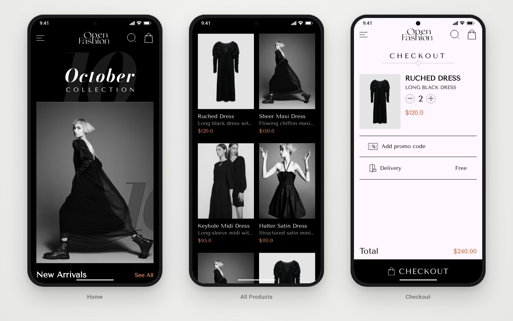

<h1 align="center">Fashion</h1>

<p align="center">
  <b>A minimal, editorial-style fashion store built with Flutter and Firebase.</b><br/>
  Browse the collection, check out in two steps and pay with a live credit-card preview.
</p>

<p align="center">
  
  
  
  
  
</p>

<p align="center">
  
  <br/><sub>Home · All products · Checkout</sub>
</p>

---

## 📖 About

**Fashion** is the customer storefront of a two-app e-commerce project; products are managed from its companion **[fashion_dashboard](https://github.com/youssef336/fashion_dashboard)**. It was built while learning Flutter + Firebase e-commerce development, and practises Clean Architecture, Bloc/Cubit state management, dependency injection with `get_it`, functional error handling with `dartz`, and Firestore-backed data.

## ✨ Features

- 🔐 **Sign up & login** with email and password (Firebase Auth)
- 🏠 **Home** — cover banners, featured products and a store contact / opening-hours section
- 👗 **All products** — catalog loaded from the Firestore `products` collection, with skeleton loading (`skeletonizer`)
- 🛒 **Two-phase checkout** — order summary with delivery and total, then shipping address
- 💳 **Payment** — card form with an animated card preview (`flutter_credit_card`) and a payment-success dialog
- 🎛 **Remote access switch** — on launch the app reads a Firestore flag (`pay/1` → `isPay`) that enables or locks the storefront
- 🎨 Custom **Tenor Sans** typography and SVG icons (`flutter_svg`)

## 🛠 Tech stack

| Concern | Choice |
|---|---|
| Framework | Flutter, Dart 3 |
| State management | `bloc` / `flutter_bloc` (Cubits for login, sign-up, products, access check) |
| Architecture | Feature-first Clean Architecture, repository pattern, `get_it` DI, `dartz` `Either` |
| Backend | Firebase Auth, Cloud Firestore |
| UI | `flutter_svg`, `skeletonizer`, `modal_progress_hud_nsn`, `flutter_credit_card` |
| CI | Codemagic workflow that builds the iOS simulator app (`codemagic.yaml`) |

## 🏗 Project structure

```
lib/
├── core/
│   ├── entities/ models/      # ProductEntity / ProductModel
│   ├── repo/fetchproduct/     # product repository
│   ├── services/              # auth + database abstractions, Firebase implementations, get_it
│   └── utils/ helper_functions/ errors/
└── features/
    ├── splash/                # access check + splash
    ├── auth/                  # login, sign up
    ├── home/                  # home, all products
    └── check_out/             # checkout, address, payment
```

## 🚀 Getting started

**Prerequisites:** Flutter SDK (Dart `^3.8`) and a Firebase project.

```bash
git clone https://github.com/youssef336/fashion_app.git
cd fashion_app
flutter pub get
flutter run
```

**Configuration**
1. Run `flutterfire configure` to connect your own Firebase project (Email/Password auth + Firestore).
2. In Firestore, create a `products` collection (`name`, `description`, `price`, `image`) — or add products from the [dashboard](https://github.com/youssef336/fashion_dashboard).
3. Create the document `pay/1` with `{ "isPay": true }` so the storefront opens.

## 👤 Author

**Youssef Belal Zakaria** · [GitHub @youssef336](https://github.com/youssef336)

⭐ If you like this project, give it a star!
